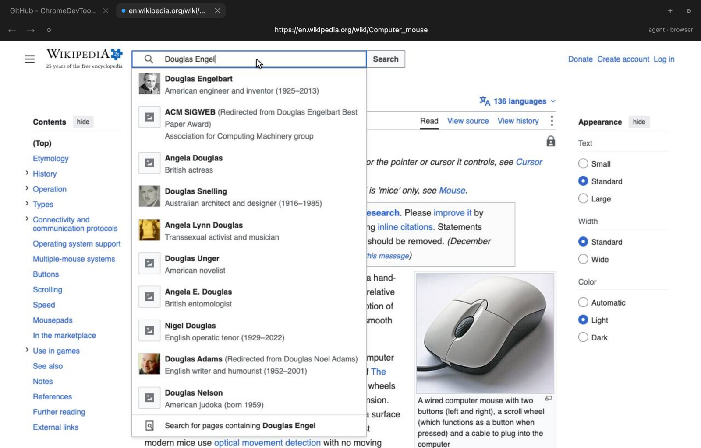
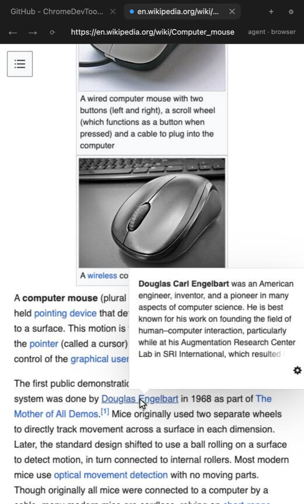
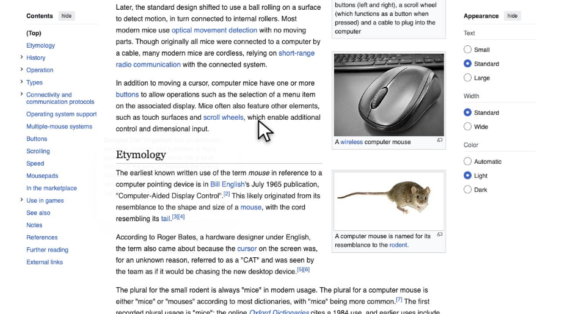
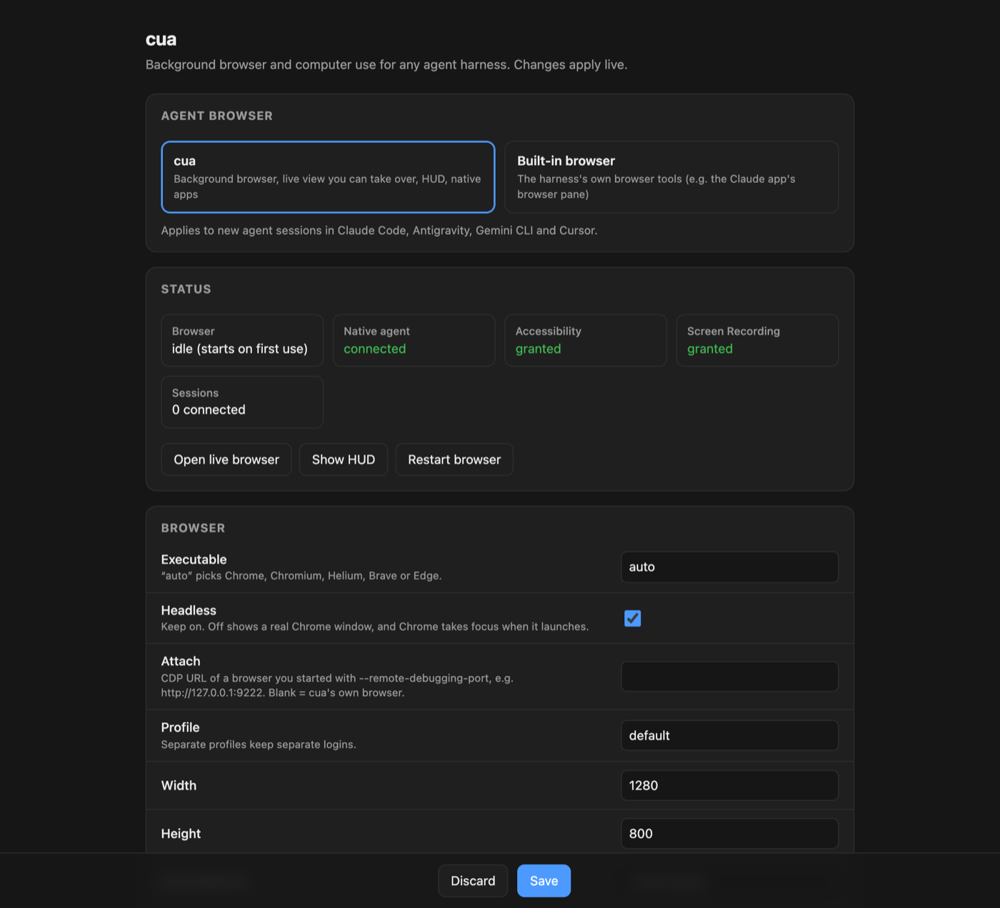
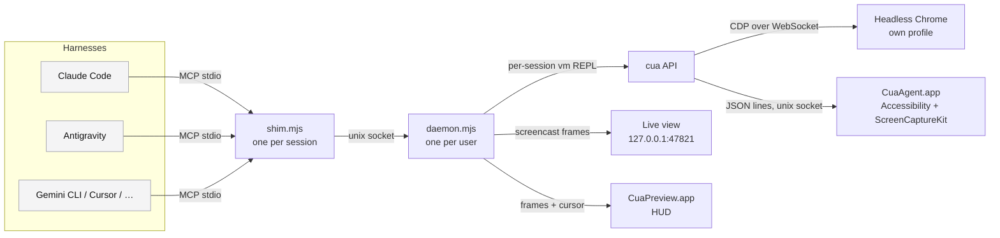

<h1 align="center">cua</h1>

<p align="center">
  <b>Codex-style background browser and computer use for any agent harness.</b><br>
  Claude Code · Antigravity · Gemini CLI · Cursor · anything that speaks MCP
</p>

<p align="center">
  
  
  
  
</p>

<p align="center">
  
</p>

cua gives an agent its own browser and its own cursor. The agent works in a headless
browser and in native macOS apps **entirely in the background**. Your mouse and keyboard
stay yours, and your windows don't jump to the front. You watch it work in a live view
that fits in a sidebar or a floating HUD, and you can take over at any moment.

It speaks the same API as the ChatGPT app's in-app browser (`agent` / `browser` / `tab`
with `ax`, `playwright`, `dom_cua`, `cua` and capabilities) and its computer use (`sky`),
so code and habits written for Codex work unchanged, from any model and any harness. It is
an independent reimplementation on public APIs (Chrome DevTools Protocol, macOS
Accessibility, ScreenCaptureKit, Playwright): no Codex or ChatGPT code or assets are used or
shipped.

## Contents

- [Highlights](#highlights)
- [Screenshots](#screenshots)
- [Install](#install)
- [Using it](#using-it)
- [API at a glance](#api-at-a-glance)
- [In the Claude app](#in-the-claude-app)
- [Switching to the built-in browser](#switching-to-the-built-in-browser)
- [The HUD](#the-hud)
- [Configuration](#configuration)
- [CLI](#cli)
- [How it works](#how-it-works)
- [Security and privacy](#security-and-privacy)
- [Troubleshooting](#troubleshooting)
- [Uninstall](#uninstall)
- [Project layout](#project-layout)

## Highlights

- **The ChatGPT app's API, anywhere.** Accessibility-indexed actions, Playwright locators
  (frames, roles, actionability waits), a visible-DOM view with node ids, coordinate
  actions, dialogs, downloads, file choosers, the browser's own clipboard, page exports
  (Markdown, Google Docs/Sheets/Slides, YouTube transcripts), raw CDP with event paging, page
  asset bundling, WebMCP tools, and `sky` for native apps.
- **One tool, a real REPL.** The agent gets a single `js` tool backed by a persistent
  JavaScript session. `const tab = …` survives between calls, and loops, retries and
  conditionals run in one round trip instead of one tool call per click.
- **Compact reads that diff.** Pages and apps come back as an indexed accessibility tree.
  After the first read, the agent only gets what changed.
- **Never touches your cursor.** Browser input goes to the page through CDP. Native apps
  are driven through Accessibility actions, and key events go to one process only.
  Nothing moves the system pointer or types into whatever you're using.
- **Its own cursor.** A rounded, glowing arrowhead that moves on springs: long moves curve
  and turn along their heading, short ones scoot, and it settles with a small wiggle. Actions
  wait for it to arrive, so what you see is what the agent does. Same motion in the live
  view and the HUD.
- **Live view you can take over.** A Codex-style browser UI (tabs, address bar, back and
  forward) streams the tab the agent is driving at up to 60 fps. The page is rendered at
  the pane's exact size, so it fills the pane. Clicks, scrolling and typing in the view go
  straight to the page.
- **Native apps too.** Read, click, type, scroll and screenshot any Mac app through the
  same indexed model, including windows that are covered.
- **Works in every harness at once.** One daemon per user. Every harness shares the same
  browser, profile and logins, and each agent session gets its own REPL.
- **Configurable.** A settings page generated from the config schema, where changes apply
  live.

## Screenshots

<table>
  <tr>
    <td width="42%" valign="top">
      
    </td>
    <td valign="top">
      <b>Sidebar-sized live view.</b> The page is re-laid-out for whatever pane it's in,
      so it fills a narrow sidebar with no letterboxing. This is how it looks inside the
      Claude app's browser pane.<br><br>
      
      <br>
      <b>The HUD.</b> A borderless card that streams the agent's tab (or the native window
      it's driving). Controls appear on hover, and you can drag it anywhere. It can attach
      to your harness's window and hide when that app isn't active.
    </td>
  </tr>
</table>

<p align="center">
  
  <br><i>Settings: the cua ↔ built-in browser switch, live status, and every option.</i>
</p>

## Install

```sh
git clone git@github.com:andymsun/cua-bridge.git ~/.local/share/cua-bridge
~/.local/share/cua-bridge/install.sh
```

**Requirements:** macOS 14+, Node 22+ (for the built-in WebSocket), Xcode command line
tools, and a Chromium-family browser (Chrome, Chromium, Helium, Brave or Edge).

The installer:

1. Builds two small apps into `~/Applications`:
   - **CuaAgent**, which holds the macOS permissions.
   - **CuaPreview**, the HUD, which needs no permissions.
2. Registers the `cua` MCP server with every harness it finds: Claude Code, Antigravity,
   Antigravity IDE, Gemini CLI and Cursor. Pass `--with-codex` to add Codex too.
3. Installs the Claude Code skill and the `cua` CLI (`~/.local/bin/cua`).

Re-running it updates everything. CuaAgent is only rebuilt when its source changes
(`--rebuild-agent` forces it), because macOS ties permissions to the app's signature.

Browser control works right away. For native apps, grant **CuaAgent** once in System
Settings › Privacy & Security › **Accessibility** and **Screen Recording**, then check with
`cua doctor`:

```text
✓ node 25.2.1 (need 22+ for built-in WebSocket)
✓ browser: /Applications/Google Chrome.app/Contents/MacOS/Google Chrome
✓ native agent: ~/Applications/CuaAgent.app
✓ HUD: ~/Applications/CuaPreview.app
✓ config: ~/.config/cua/config.json
✓ registered in: Claude Code, Antigravity, Antigravity IDE
✓ Accessibility granted to CuaAgent (native apps)
✓ Screen Recording granted to CuaAgent (native screenshots, HUD for apps)
```

### Other harnesses

cua is a plain MCP stdio server. Anything that can launch one can use it:

```json
{
  "mcpServers": {
    "cua": { "command": "node", "args": ["/Users/you/.local/share/cua-bridge/server/shim.mjs"] }
  }
}
```

## Using it

The agent calls one tool, `js`, with JavaScript. `agent`, `sky` and `nodeRepl` are ready in
every session, top-level `const` persists between calls, and the last expression is
returned:

```js
const browser = await agent.browsers.getDefault();
const tab = await browser.tabs.new();
await tab.goto("https://en.wikipedia.org/wiki/Special:Search");
await tab.ax.write();
```

```text
Tab 9C4CE163 · Search - Wikipedia · https://en.wikipedia.org/wiki/Special:Search
1 link "Jump to content"
…
7 searchbox "Search Wikipedia"
8 button "Search"
…
```

Act by index, or with Playwright locators for forms and repetitive work, then read again.
Later reads return only what changed:

```js
await tab.playwright.getByRole("searchbox", { name: "Search Wikipedia" }).fill("Engelbart");
await tab.ax.pressKey(null, "Return");
await tab.ax.write();      // (changes since last read: +38 −4, …)
```

Native apps work the same way:

```js
const s = await sky.get_app_state({ app: "Notes" });   // { app, text, screenshot: { url } }
await sky.click({ app: "Notes", element_index: 7 });
await sky.type_text({ app: "Notes", text: "groceries" });
```

`cua.open(url)` and `cua.app(name)` remain as a shorter API over the same engine.

## API at a glance

The agent reads the full guide with `browser.documentation()`, and topics with
`agent.documentation.get(name)` (accessibility, file-uploads, computer-use, …). The sources
are in [`server/docs`](server/docs).

| Area | Calls |
| --- | --- |
| Browser | `agent.browsers.getDefault()`, `browser.tabs.new/get/list/selected`, `tabs.content({ urls })`, `nameSession(name)`, capabilities `visibility`, `viewport` |
| Tab | `goto`, `back`, `forward`, `reload`, `close`, `url`, `title`, `screenshot({ fullPage, clip })`, `getJsDialog()`, `markDeliverable()`, `markHandoff()` |
| `tab.ax` | `write/get("state" \| "screenshot" \| "both")`, `click`, `typeText`, `setValue`, `pressKey`, `paste`, `selectText`, `scroll`, `drag`, `performSecondaryAction` |
| `tab.playwright` | `getByRole/Text/Label/Placeholder/TestId`, `locator`, `frameLocator` → `click`, `fill`, `press`, `check`, `selectOption`, `setInputFiles`, reads; `evaluate`, `waitForURL`, `waitForLoadState`, `expectNavigation`, `waitForEvent("download" \| "filechooser")`, `domSnapshot`, `elementInfo`, `elementScreenshot` |
| `tab.dom_cua` | `get_visible_dom()` (all frames, node ids), `click`, `double_click`, `scroll`, `type`, `keypress`, `downloadMedia` |
| `tab.cua` | coordinate `click`, `double_click`, `move`, `drag`, `scroll`, `type`, `keypress`, `downloadMedia` |
| Tab extras | `clipboard` (the browser's own), `content.export()`, `exportGsuite(type)`, `exportYouTubeTranscript()`, `dev.logs()`, capabilities `cdp`, `pageAssets`, `webmcp` |
| `sky` | `list_apps`, `get_app_state`, `click`, `set_value`, `type_text`, `press_key`, `paste`, `scroll`, `select_text`, `perform_secondary_action`, `drag` |

Extension-only parts of the ChatGPT app's API (your own browser's open tabs and history)
report that they aren't available here.

## In the Claude app

cua's live view is a local web page, so any harness with a browser pane can show it. In the
Claude desktop app, the bundled skill tells Claude to open it in the browser sidebar as
soon as browser work starts. That gives you a Codex-style in-app browser while still using
Claude:

1. The first `cua.open()` of a session prints `Live view for the user: <url>`.
2. Claude opens that URL in its browser pane (`preview_start`).
3. The pane mirrors whichever tab cua is driving, sized to fill it. Click, scroll or type
   in it to hand the agent back a page, finish a login, or complete a CAPTCHA.

`cua ui` opens the same view in your default browser.

## Switching to the built-in browser

You can flip every harness between cua and its own built-in browser (such as the
Claude app's browser pane tools) in one step:

```sh
cua toggle                 # flip
cua use builtin            # or pick one explicitly
cua use cua
cua use                    # show the current choice
```

The settings page has the same switch at the top. Switching changes only the entries cua
manages:

| Harness | cua selected | Built-in browser selected |
| --- | --- | --- |
| Claude Code / Claude app | Built-in page-driving browser tools are denied in `~/.claude/settings.json` (`preview_*` stays allowed so the live view can open) | `mcp__cua` is denied instead, and the cua skill is parked |
| Antigravity, Gemini CLI, Cursor | The `cua` server entry is present | The entry is parked in `~/.config/cua/parked-servers.json` and restored when you switch back |

The rest of each config is left alone. Unreadable configs are skipped rather than
overwritten, and symlinked configs are written through. Re-running the installer
re-applies your current choice. Uninstalling removes every rule cua added. The change
applies to new agent sessions, so restart any harness window that's already open.

## The HUD

`CuaPreview.app` is a small borderless card that streams what the agent is driving: the
active browser tab, or the native window when it's working in an app. It draws the agent's
cursor and click ripples on top.

- **Hover** to show the controls: close, and take over. Take over opens the live view, or
  brings the native app forward.
- **Drag** it from anywhere on the card.
- **Modes:**
  - `attached` (the default) pins the HUD to a host app's window, such as Claude, and
    hides it when that app isn't active.
  - `overlay` floats the HUD above everything.
  - `normal` makes it an ordinary window.
- Size, corner, opacity, glyphs, tint, scrim and fade timings are all configurable.

## Configuration

`cua settings` opens the settings page, and changes apply live. The file lives at
`~/.config/cua/config.json` and stores only what you changed from the defaults.
[`config.example.json`](config.example.json) lists every key.

| Section | Key options |
| --- | --- |
| `browser` | `executable` (`auto` or a path), `headless`, `attach` (a CDP URL of a browser to drive instead), `profile`, `viewport`, `downloadsDir`, `dialogs` (`report`/`accept`/`dismiss`), `closeTabsOnSessionEnd` |
| `snapshot` | `diff`, `maxLines`, `maxTextLength` |
| `native` | `enabled`, `allowKeyEvents`, `maxDepth`, `maxLines` |
| `stream` | `fps` (default 30), `quality`, `maxWidth` |
| `hud` | `enabled`, `mode`, `attachTo`, `anchor`, `hideWhenHostInactive`, `width`, `opacity`, `cornerRadius`, `clickThrough`, `showAgentCursor`, `controlsCorner`, glyph and fade options |
| `web` | `port` (default 47821) |
| `repl` | `timeoutMs`, `maxOutputChars` |

Environment overrides: `CUA_CONFIG` (config file path) and `CUA_RUN_DIR` (sockets, token,
logs).

## CLI

| Command | What it does |
| --- | --- |
| `cua status` | Daemon, browser, and native agent state, plus the live view and settings URLs |
| `cua start` / `stop` / `restart` | Manage the daemon (it also starts on the first tool call) |
| `cua ui` | Open the live browser view |
| `cua settings` | Open the settings page |
| `cua doctor` | Check Node, browser, apps, harness registration and permissions |
| `cua use [cua\|builtin]` / `cua toggle` | Choose which browser agents use |

## How it works



- **shim → daemon.** Each harness launches `shim.mjs`, a tiny MCP server that forwards
  calls to a single per-user daemon (and starts it if needed). The browser and its logins
  are shared, and each session gets its own REPL.
- **REPL.** Each session is a Node `vm` context. Top-level declarations are hoisted so they
  persist, a single trailing expression is returned automatically, and output is capped.
- **Browser engine.** A zero-dependency CDP client with flattened sessions.
  - Reads come from `Accessibility.getFullAXTree`, filtered to meaningful roles and
    indexed, with multiset diffs between reads.
  - Input goes through `Input.dispatch*`, so it's page-level and never touches the OS.
  - The live view uses `Page.startScreencast`, with the page's metrics matched to the
    viewer's size.
- **Locators.** Playwright (`playwright-core`, no browser download) connects to the same
  Chrome as a second CDP client, so `tab.playwright` has Playwright's exact semantics while
  input still goes to the page, never the OS.
- **Cursor sync.** Every agent action announces a cursor move; the live view animates it and
  reports when it has arrived, and the action waits for that (up to about a second), so the
  cursor you see is where the agent acts.
- **Native agent.** A Swift app that owns the Accessibility and Screen Recording grants.
  - It builds indexed AX snapshots per process.
  - It presses, sets values, scrolls and hit-tests through AX.
  - Keys are sent with `CGEvent.postToPid`, to that process only.
  - Windows are captured with ScreenCaptureKit, even when they're covered.
- **Live view.** A token-gated local page. One WebSocket carries frames down and input,
  navigation and viewport size up. Slow viewers drop old frames instead of queueing them.

## Security and privacy

- The web UI binds to `127.0.0.1` only and requires a random per-install token.
- Nothing leaves your machine except the pages the agent visits.
- The agent's browser uses its own profile under
  `~/Library/Application Support/cua/profiles`. It never sees your normal browser's
  cookies unless you point `browser.attach` at it.
- Page content is treated as untrusted. The skill and tool description tell agents to
  confirm before sending messages, submitting forms with side effects, buying things,
  deleting data or entering credentials.
- Agents are told never to solve CAPTCHAs. They hand them to you in the live view.

## Troubleshooting

| Symptom | Fix |
| --- | --- |
| Native apps say permission denied | Grant CuaAgent **Accessibility** and **Screen Recording**, then run `cua doctor`. After `--rebuild-agent`, grant them again. |
| A site blocks the headless browser or keeps showing CAPTCHAs | Browsers started with a debugging port are detectable as automated, and cua doesn't hide that. Finish the check yourself in the live view, or set `browser.attach` to a browser you started with `--remote-debugging-port`. |
| Live view is blank | Run `cua status`. The browser starts on the first `cua.open()`, and `cua restart` resets everything. |
| The agent doesn't have the tool | Start a new conversation after installing, because harnesses load MCP servers at session start. |
| You want the harness's own browser for a while | `cua toggle`, then again to come back. |
| Anything else | The daemon log is at `~/Library/Application Support/cua/run/daemon.log`. |

Turning `browser.headless` off shows a real Chrome window, but Chrome takes focus when it
launches. That's why the default is headless.

## Uninstall

```sh
~/.local/share/cua-bridge/uninstall.sh          # keeps your config and browser profiles
~/.local/share/cua-bridge/uninstall.sh --purge  # removes those too
```

## Project layout

```text
server/
  shim.mjs               MCP stdio server each harness registers
  daemon.mjs             per-user daemon: browser, native agent, HUD feed, web UI, sessions
  cli.mjs                the `cua` command
  tool-description.md    API guide shown to agents
  lib/
    browser.mjs          CDP engine: tabs, snapshots, input, dialogs, logs, network, screencast
    cdp.mjs              minimal CDP client over Node's WebSocket
    snapshot.mjs         AX tree → indexed text, and diffs
    repl.mjs             persistent per-session vm REPL
    api.mjs              the session globals: cua, agent, sky, nodeRepl
    codex.mjs            the ChatGPT-compatible browser API (agent / browser / tab)
    sky.mjs              the ChatGPT-compatible computer-use API
    pw.mjs               Playwright on cua's browser, for locators
    visible-dom.mjs      in-page script behind dom_cua.get_visible_dom()
    docs.mjs             serves server/docs
    native.mjs           client for CuaAgent
    hud.mjs              HUD feed (frames, cursor, source)
    web.mjs              live view + settings server, WebSocket stream
    config.mjs           defaults, paths, overrides-only saving
    keys.mjs             "ctrl+shift+t" → CDP key events
  web/
    browser.html         live view
    cursor.js            the agent cursor (springs, curves, arrival events)
    settings.html        settings page
  docs/                  guides agents read on demand (browser, accessibility, computer-use, …)
agent/CuaAgent.swift     Accessibility + ScreenCaptureKit agent
hud/CuaPreview.swift     the HUD
skill/SKILL.md           Claude Code skill
docs/                    screenshots
install.sh · uninstall.sh · config.example.json
```
